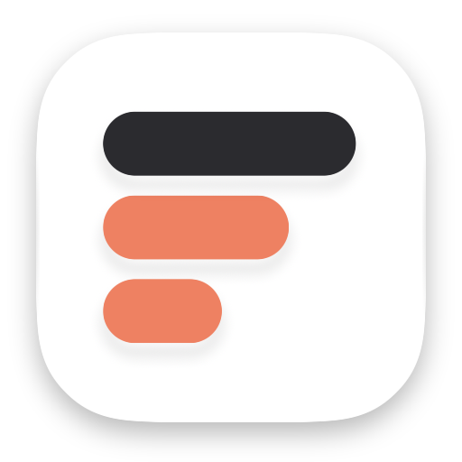

<p align="center">
  <picture>
    <source media="(prefers-color-scheme: dark)" srcset="docs/images/logo-dark.png">
    
  </picture>
</p>

<h1 align="center">Folio</h1>

<p align="center">과목을 중심으로 학업을 관리하는 앱</p>

## 기능

- **과목**: 강의 회차, 자료, 노트, 과제, 시험을 과목 하나에 모읍니다.
- **노트**: 마크다운 노트에 수식, 콜아웃, 노트 사이 링크를 씁니다.
- **복습과 퀴즈**: 단원 단위로 간격을 두고 복습하고, 서술형 답은 Claude가 채점합니다.
- **성적**: 평가 기준으로 환산 점수, 평점, 졸업 요건을 계산합니다.
- **녹음**: 강의를 녹음하고 기기 안에서 글로 받아씁니다.
- **파일**: 모든 데이터는 iCloud Drive의 파일로 남습니다.

## 명령줄 도구

앱에서 하는 모든 데이터 변경을 터미널과 AI 에이전트에서도 `folio`로 할 수 있습니다. `folio mcp`는 같은 동작을 MCP 도구로 엽니다.

```bash
mise run install-cli          # ~/.local/bin에 설치
folio today
folio help "과제 추가"         # 하고 싶은 일로 명령 찾기
```

## 개발

```bash
mise run generate
open Folio.xcodeproj
```

빌드, 테스트, 구조와 규칙은 [AGENTS.md](AGENTS.md)에 있습니다.
