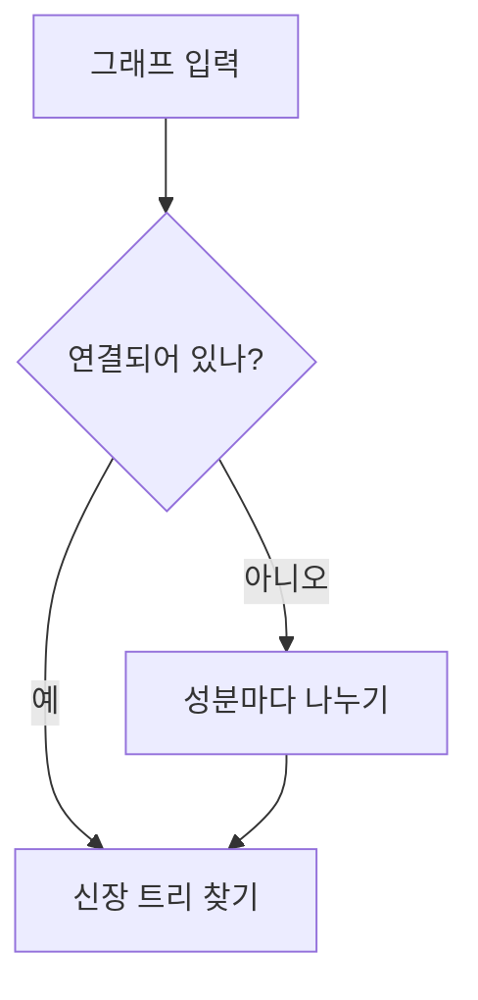
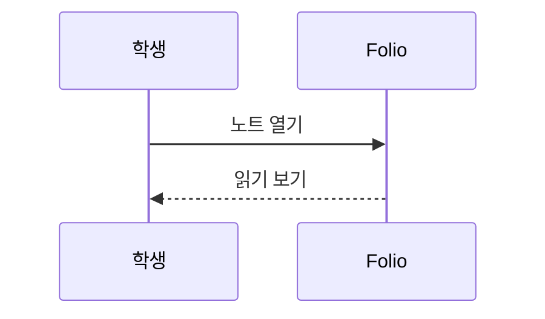

# 마크다운 문법 모음

평범한 문단입니다. 한국어와 English가 섞인 줄이 길게 이어져서 줄바꿈이 어떻게 되는지 볼 수 있도록 조금 더 길게 적어 둡니다.
원문의 줄바꿈은 읽기 보기에서도 줄바꿈입니다.

**굵게**, *기울임*, ***굵은 기울임***, ~~취소선~~, `인라인 코드`, 그리고 **굵게 안의 *기울임***.
이스케이프: \*별표\*, \# 샵, 1\. 숫자 점, \$달러\$.

## 링크

- 웹 링크: [Apple](https://www.apple.com)
- 자동 링크: <https://example.com>
- 위키링크: [[2주차-1]], 별칭: [[2주차-1|지난 강의]], 제목: [[2주차-1#정의]], 블록: [[2주차-1#^def-graph|그래프 정의]]
- 옵시디언: [볼트 열기](obsidian://open?vault=Brain&file=Graph)
- 자료 링크: [[material:00000000-0000-0000-0000-000000000000#page=12]]

## 목록

- 하나
- 둘
    - 안쪽 하나
    - 안쪽 둘
        - 더 안쪽
- 셋

1. 첫째
2. 둘째
    1. 둘째의 첫째
3. 셋째

- [ ] 할 일
- [x] 끝낸 일
- [ ] 수식이 든 할 일 $a^2$

1. [ ] 번호 있는 할 일
2. [x] 번호 있는 끝낸 일
    - [ ] 안쪽 할 일

목록 뒤의 문단입니다. ^after-list

### 셋째 단계 제목

#### 넷째 단계 제목

##### 다섯째 단계 제목

###### 여섯째 단계 제목

## 수식

인라인 수식 $e^{i\pi} + 1 = 0$ 과 $\sum_{k=1}^{n} k = \frac{n(n+1)}{2}$ 이 문장 안에 있습니다.

$$
\int_0^1 x^2 \, dx = \frac{1}{3}
$$

$$\det(A - \lambda I) = 0$$

$$
\begin{pmatrix} 1 & 2 \\ 3 & 4 \end{pmatrix}
\begin{pmatrix} x \\ y \end{pmatrix}
=
\begin{pmatrix} 5 \\ 6 \end{pmatrix}
$$

$$
f(x) = \begin{cases} x & x \ge 0 \\ -x & x < 0 \end{cases}
$$

$$
\begin{aligned}
(a+b)^2 &= a^2 + 2ab + b^2 \\
(a-b)^2 &= a^2 - 2ab + b^2
\end{aligned}
$$

잘못된 수식: $\notacommand{x}$

## 인용과 콜아웃

> 평범한 인용입니다.
> 두 줄째.
>
> > 겹친 인용.

> [!definition] 그래프
> 정점 집합 $V$와 간선 집합 $E$의 쌍 $G = (V, E)$.

> [!theorem] 악수 정리
> 모든 그래프에서 $\sum_{v \in V} \deg(v) = 2|E|$.

> [!proof]
> 간선 하나는 차수 합에 정확히 2를 더한다.

> [!example] 예시
> - 목록이 든 콜아웃
> - $K_3$은 삼각형

> [!warning]- 접힌 경고
> 처음에는 접혀 있어야 합니다.

> [!tip] 팁
> **굵게**와 `코드`도 들어갑니다. ^tip-block

> [!note]
> 제목 없는 노트 콜아웃.

## 코드

```python
def degree_sum(graph):
    # 차수의 합
    return sum(len(n) for n in graph.values())
```

```swift
let edges = [(1, 2), (2, 3)]
```

```
언어 없는 코드 블록
```

~~~js
const x = 1;
~~~

## 다이어그램





```mermaid
이건 다이어그램이 아니다
```

## 표

| 이름 | 정점 | 간선 |
| :--- | :---: | ---: |
| $K_3$ | 3 | 3 |
| **완전 그래프** $K_n$ | $n$ | $\binom{n}{2}$ |
| 경로 | `n` | n-1 |

```cb-table
{"columns": [{"width": 120}, {"align": "center"}], "rows": [{"header": true, "cells": [{"text": "항목"}, {"text": "설명"}]}, {"cells": [{"text": "병합", "colspan": 2}]}, {"cells": [{"text": "목록"}, {"text": "- 하나\n- 둘"}]}]}
```

## 그림, 임베드, 위젯


![[2주차-1]]

```cb-widget
{"id": "11111111-2222-3333-4444-555555555555", "height": 120}
```

## 구분선과 기타

위
***
아래

---

<span>인라인 HTML</span>은 글자 그대로 보입니다.

<div>
HTML 블록
</div>

마지막 문단.
